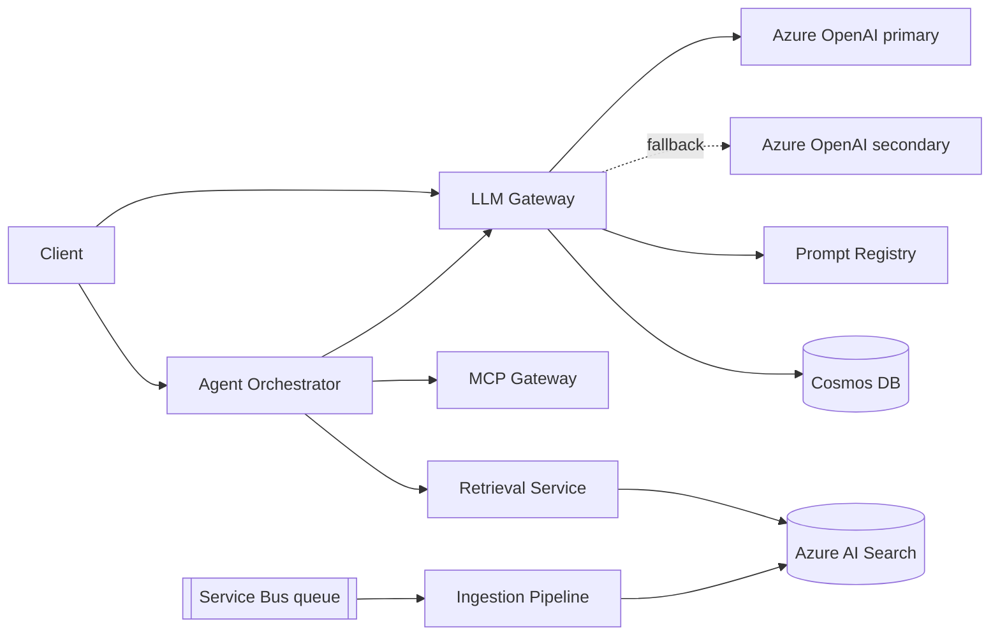

# enterprise-genai-platform

A multi-tenant GenAI platform: the layer an enterprise assistant sits on. NestJS + TypeScript
microservices, an Azure OpenAI gateway with fallback, hybrid RAG on Azure AI Search, an MCP tool
gateway, Entra ID (OIDC/JWT) auth, evaluation gates in CI, OpenTelemetry observability and AKS
deployment.

> **Status:** under active construction, built step by step. See the [roadmap](#roadmap).

## Architecture (target)



## Repository layout

| Path               | Purpose                                                                              |
| ------------------ | ------------------------------------------------------------------------------------ |
| `apps/llm-gateway` | Azure OpenAI gateway: limits, retries, fallback ([docs](apps/llm-gateway/README.md)) |
| `apps/*`           | Deployable services (one Docker image each)                                          |
| `packages/shared`  | `@genai/shared`: tenant context and cross-service helpers                            |
| `docs/adr`         | Architecture decision records: why X over Y                                          |
| `.github/`         | CI workflow and PR template                                                          |

## Getting started

Requires Node 22+.

```bash
npm install
npm run lint && npm run typecheck && npm test
```

Try the gateway locally with no cloud account (mock provider): see
[apps/llm-gateway](apps/llm-gateway/README.md#run-it-locally-no-cloud-account-needed).

## Roadmap

- [x] **Step 1: Foundation.** Monorepo, TypeScript strict config, lint/format, conventional
      commits with hooks, CI, ADRs, `@genai/shared` tenant context
- [x] **Step 2: LLM gateway.** Per-tenant rate limits and token quotas, retries with jittered
      backoff, fallback deployment, error classification (ADR 0003)
- [ ] **Step 3: Prompt registry.** Versioning, rollback, A/B comparison
- [ ] **Step 4: Ingestion pipeline.** Queue-driven, per-file-type chunking, idempotent, DLQ
- [ ] **Step 5: Retrieval service.** Hybrid search, reranking, per-tenant/per-role filters
- [ ] **Step 6: Auth.** Entra ID OIDC, JWT validation, on-behalf-of flow, Key Vault
- [ ] **Step 7: Guardrails.** PII redaction, prompt-injection checks, output filtering
- [ ] **Step 8: Agent orchestrator.** Tool calling, step limits, timeouts, human approval
- [ ] **Step 9: MCP gateway.** Server registry, permissions, audit logs
- [ ] **Step 10: Cost and performance.** Semantic cache, per-tenant cost tracking, streaming
- [ ] **Step 11: Evaluation pipeline.** Groundedness/relevance gates that block deploys
- [ ] **Step 12: Observability.** OpenTelemetry traces, SLO dashboards and alerts
- [ ] **Step 13: Delivery.** Docker, Helm, AKS, canary rollout, Bicep/Terraform
- [ ] **Step 14: Proof.** Load-test results, cost-savings numbers, eval scores

## Decisions

Design choices and their trade-offs live in [`docs/adr`](docs/adr/README.md).

## Contributing

See [CONTRIBUTING.md](CONTRIBUTING.md) for the branch, commit and PR conventions.
