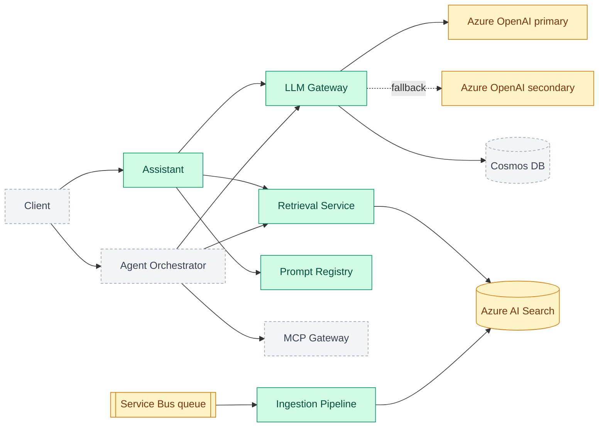

# enterprise-genai-platform

A multi-tenant GenAI platform: the layer an enterprise assistant sits on. NestJS + TypeScript
microservices, an Azure OpenAI gateway with fallback, hybrid RAG on Azure AI Search, an MCP tool
gateway, Entra ID (OIDC/JWT) auth, evaluation gates in CI, OpenTelemetry observability and AKS
deployment.

> **Honest status:** this is built step by step in the open. Five services, two shared libraries
> and a cross-service end-to-end test are done, and one real path works: **a user with a token asks
> a question and gets a cited answer, seeing only what their role allows** (run it with
> `npm run demo -w @genai/e2e`). It all runs on **local stand-ins**: an in-memory queue, index and
> stores, a deterministic **mock model** (not an LLM), and locally generated signing keys instead of
> Entra ID. Nothing has been run against real Azure yet, and uploads are not yet wired into search.
> The diagram below is the **target**, colour-coded by what exists today.

## Status

✅ Done · 🚧 In progress · 📋 Planned

| Area                 | Status     | What exists today                                                                                          | Still stubbed or missing                                                 |
| -------------------- | ---------- | ---------------------------------------------------------------------------------------------------------- | ------------------------------------------------------------------------ |
| Monorepo, CI, ADRs   | ✅ Done    | npm workspaces, strict TS, lint/format, commit hooks, GitHub Actions                                       | -                                                                        |
| LLM gateway          | ✅ Done    | Rate limits, token quotas, retries, fallback, error mapping                                                | Azure client untested against real Azure; no cache                       |
| Prompt registry      | ✅ Done    | Versions, audited rollback, sticky A/B, safe templates                                                     | In-memory storage (no Cosmos DB yet)                                     |
| Ingestion pipeline   | ✅ Done    | Queue with DLQ, chunking per file type, idempotent indexing                                                | In-memory queue/index; no PDF/Office; 200 KB limit                       |
| Retrieval service    | ✅ Done    | BM25 + vector, rank fusion, rerank, role/tenant trimming                                                   | Hash embedder (spelling, not meaning); in-memory                         |
| Auth (Entra ID)      | ✅ Done    | JWT validation, secure-by-default guard, role gates, OBO client                                            | Not run against real Entra ID; OBO and Key Vault not wired yet           |
| **Vertical slice**   | ✅ Done    | `assistant`: asks as the user, retrieves, uses the registry prompt, verifies citations; e2e over real HTTP | Mock model (deterministic test double); ingestion not wired to retrieval |
| Guardrails           | 📋 Planned | -                                                                                                          | PII redaction, injection checks, output filtering                        |
| Agent orchestrator   | 📋 Planned | -                                                                                                          | Tool calling, step limits, human approval                                |
| MCP gateway          | 📋 Planned | -                                                                                                          | Server registry, permissions, audit log                                  |
| Cost and performance | 📋 Planned | Per-tenant token quota in the gateway                                                                      | Semantic cache, cost tracking, streaming                                 |
| Evaluation pipeline  | 📋 Planned | -                                                                                                          | Groundedness/relevance gates that block deploys                          |
| Observability        | 📋 Planned | -                                                                                                          | OpenTelemetry traces, SLO dashboards, alerts                             |
| Delivery             | 📋 Planned | -                                                                                                          | Docker, Helm, AKS, canary rollout, Bicep/Terraform                       |

## Architecture (target)

Green is built and tested, amber is built against a local stand-in with the Azure service still to
come, grey is planned.



## Proof: tests and a real run

Everything below was produced by running the code in this repository.

**Test suite** (`npm test`, also run by CI on every pull request, from a clean checkout):

| Package                              | Tests   |
| ------------------------------------ | ------- |
| `@genai/assistant`                   | 46      |
| `@genai/llm-gateway`                 | 56      |
| `@genai/prompt-registry`             | 59      |
| `@genai/ingestion`                   | 59      |
| `@genai/retrieval`                   | 64      |
| `@genai/auth`                        | 64      |
| `@genai/shared`                      | 9       |
| `@genai/e2e` (all services together) | 13      |
| **Total**                            | **370** |

Format check, lint, typecheck and build also pass in CI. Many are end-to-end HTTP tests (failure
injection, tenant isolation, access trimming, forged and expired tokens, spoofed headers). The 13
`e2e` tests start the real services on real ports and talk to them over HTTP. To check that test
can actually fail, access trimming was deliberately broken once: exactly the two security scenarios
failed, and passed again when restored.

**A real run** (`npm run -s demo -w @genai/e2e`): the same question from callers with different
roles, through the assistant, retrieval, the prompt registry and the gateway, using signed tokens.
The confidential document is restricted to `manager`:

```text
Bob (acme-bank, roles: analyst) asks: "How long do refunds take?"
  answer:    Refunds take five working days to reach the original card. [1]
  grounded:  true   sources retrieved: 1
  citation:  [1] handbook > Refunds  (handbook:0)

Bob (acme-bank, roles: analyst) asks: "What are the salary bands for managers?"
  answer:    I could not find anything about that in the documents available to you.
  grounded:  false   sources retrieved: 0
  (no sources the caller may see, so the model was never called)

Alice (acme-bank, roles: manager) asks: "What are the salary bands for managers?"
  answer:    Salary bands for managers start at level M1 and are reviewed every year. [1]
  grounded:  true   sources retrieved: 1
  citation:  [1] salary-bands > Salary bands  (salary-bands:0)

Gina (globex, roles: analyst) asks: "How long do refunds take?"
  answer:    Refunds take ten working days at Globex. [1]      <- her own tenant's document

Bob asks the salary question again, sending the spoofed header x-roles: manager
  answer:    I could not find anything about that in the documents available to you.

Alice presents a token issued for the retrieval API to the assistant
  -> HTTP 401 unauthorized (tokens are bound to one service)
```

The model here is a deterministic stand-in, so what this proves is the **path and the access
control**, not answer quality. Bob never sees the salary document, the model is not even called for
him, and a citation only ever points at a chunk that was really retrieved for that user.

## Repository layout

| Path                   | Purpose                                                                                       |
| ---------------------- | --------------------------------------------------------------------------------------------- |
| `apps/assistant`       | Ask a question, get a cited answer, as the user ([docs](apps/assistant/README.md))            |
| `apps/llm-gateway`     | Azure OpenAI gateway: limits, retries, fallback ([docs](apps/llm-gateway/README.md))          |
| `apps/prompt-registry` | Versioned prompts, rollback, A/B ([docs](apps/prompt-registry/README.md))                     |
| `apps/ingestion`       | Queue-driven document ingestion ([docs](apps/ingestion/README.md))                            |
| `apps/retrieval`       | Hybrid search with access trimming ([docs](apps/retrieval/README.md))                         |
| `packages/auth`        | `@genai/auth`: JWT validation, guard, on-behalf-of, secrets ([docs](packages/auth/README.md)) |
| `packages/shared`      | `@genai/shared`: tenant context and cross-service helpers                                     |
| `tests/e2e`            | The real services together over HTTP, plus the runnable demo                                  |
| `docs/adr`             | Architecture decision records: why X over Y                                                   |
| `.github/`             | CI workflow and PR template                                                                   |

## Getting started

Requires Node 22+.

```bash
npm install
npm run lint && npm run typecheck && npm test
```

To watch the whole path run in one command: `npm run -s demo -w @genai/e2e`.

Services require authentication. Locally you mint real signed tokens with the dev tool, no cloud
account needed (`eval "$(npm run -s dev-token -w @genai/auth -- env)"`, see
[packages/auth](packages/auth/README.md#local-development-real-tokens-no-bypass)). Each README has
copy-paste `curl` commands:
[llm-gateway](apps/llm-gateway/README.md#run-it-locally-no-cloud-account-needed),
[prompt-registry](apps/prompt-registry/README.md#run-it-locally),
[ingestion](apps/ingestion/README.md#run-it-locally) and
[retrieval](apps/retrieval/README.md#run-it-locally).

## Roadmap

The order is deliberate: finish one working path end to end (login, ask, cited answer) before
building the remaining pieces, so there is always a demonstrable system.

- [x] **Step 1: Foundation.** Monorepo, TypeScript strict config, lint/format, conventional
      commits with hooks, CI, ADRs, `@genai/shared` tenant context
- [x] **Step 2: LLM gateway.** Per-tenant rate limits and token quotas, retries with jittered
      backoff, fallback deployment, error classification (ADR 0003)
- [x] **Step 3: Prompt registry.** Append-only versions, audited rollback, sticky A/B
      experiments, safe templates (ADR 0004)
- [x] **Step 4: Ingestion pipeline.** Queue-driven with peek-lock semantics, per-file-type
      chunking, idempotent re-indexing, retries with backoff, dead-letter queue (ADR 0005)
- [x] **Step 5: Retrieval service.** Hybrid keyword + vector search, rank fusion, reranking,
      pre-filtered per-tenant and per-role access trimming (ADR 0006)
- [x] **Step 6: Auth.** JWT validation (RS256, issuer, audience, expiry), secure-by-default guard,
      role-gated admin operations, on-behalf-of client, secret providers; replaces the interim
      identity headers on every service (ADR 0007)
- [x] **Step 7: Vertical slice.** `assistant` service: asks as the user (on-behalf-of per
      downstream API), retrieves access-trimmed chunks, uses the registry prompt, calls the gateway,
      verifies citations; proven across the real services over HTTP (ADR 0008)
- [ ] **Step 8: Guardrails.** PII redaction, prompt-injection checks, output filtering
- [ ] **Step 9: Agent orchestrator.** Tool calling, step limits, timeouts, human approval
- [ ] **Step 10: MCP gateway.** Server registry, permissions, audit logs
- [ ] **Step 11: Cost and performance.** Semantic cache, per-tenant cost tracking, streaming
- [ ] **Step 12: Evaluation pipeline.** Groundedness/relevance gates that block deploys
- [ ] **Step 13: Observability.** OpenTelemetry traces, SLO dashboards and alerts
- [ ] **Step 14: Delivery.** Docker, Helm, AKS, canary rollout, Bicep/Terraform
- [ ] **Step 15: Proof.** Load-test results, cost-savings numbers, eval scores

## Decisions

Design choices and their trade-offs live in [`docs/adr`](docs/adr/README.md).

## Contributing

See [CONTRIBUTING.md](CONTRIBUTING.md) for the branch, commit and PR conventions.
