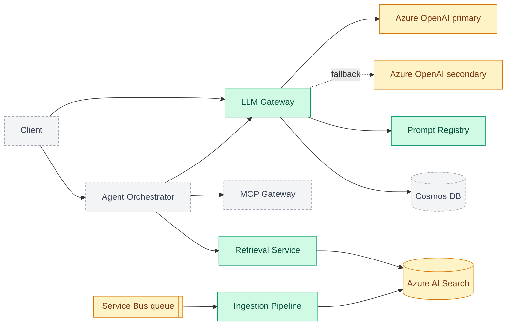

# enterprise-genai-platform

A multi-tenant GenAI platform: the layer an enterprise assistant sits on. NestJS + TypeScript
microservices, an Azure OpenAI gateway with fallback, hybrid RAG on Azure AI Search, an MCP tool
gateway, Entra ID (OIDC/JWT) auth, evaluation gates in CI, OpenTelemetry observability and AKS
deployment.

> **Honest status:** this is built step by step in the open. Four services and a shared library are
> done and tested, running on **local stand-ins** (in-memory queue, index and stores; a mock LLM).
> Nothing has been run against real Azure yet, and the end-to-end "ask a question, get a cited
> answer" path is the next milestone. The diagram below is the **target**, colour-coded by what
> exists today.

## Status

✅ Done · 🚧 In progress · 📋 Planned

| Area                 | Status     | What exists today                                                    | Still stubbed or missing                           |
| -------------------- | ---------- | -------------------------------------------------------------------- | -------------------------------------------------- |
| Monorepo, CI, ADRs   | ✅ Done    | npm workspaces, strict TS, lint/format, commit hooks, GitHub Actions | -                                                  |
| LLM gateway          | ✅ Done    | Rate limits, token quotas, retries, fallback, error mapping          | Azure client untested against real Azure; no cache |
| Prompt registry      | ✅ Done    | Versions, audited rollback, sticky A/B, safe templates               | In-memory storage (no Cosmos DB yet)               |
| Ingestion pipeline   | ✅ Done    | Queue with DLQ, chunking per file type, idempotent indexing          | In-memory queue/index; no PDF/Office; 200 KB limit |
| Retrieval service    | ✅ Done    | BM25 + vector, rank fusion, rerank, role/tenant trimming             | Hash embedder (spelling, not meaning); in-memory   |
| Auth (Entra ID)      | 📋 Planned | Interim `x-tenant-id` / `x-roles` headers                            | JWT validation, on-behalf-of flow, Key Vault       |
| **Vertical slice**   | 📋 Planned | -                                                                    | Login, ask, cited answer through all of the above  |
| Guardrails           | 📋 Planned | -                                                                    | PII redaction, injection checks, output filtering  |
| Agent orchestrator   | 📋 Planned | -                                                                    | Tool calling, step limits, human approval          |
| MCP gateway          | 📋 Planned | -                                                                    | Server registry, permissions, audit log            |
| Cost and performance | 📋 Planned | Per-tenant token quota in the gateway                                | Semantic cache, cost tracking, streaming           |
| Evaluation pipeline  | 📋 Planned | -                                                                    | Groundedness/relevance gates that block deploys    |
| Observability        | 📋 Planned | -                                                                    | OpenTelemetry traces, SLO dashboards, alerts       |
| Delivery             | 📋 Planned | -                                                                    | Docker, Helm, AKS, canary rollout, Bicep/Terraform |

## Architecture (target)

Green is built and tested, amber is built against a local stand-in with the Azure service still to
come, grey is planned.



## Proof: tests and a real run

Everything below was produced by running the code in this repository.

**Test suite** (`npm test`, also run by CI on every pull request):

| Package                  | Tests   |
| ------------------------ | ------- |
| `@genai/llm-gateway`     | 44      |
| `@genai/prompt-registry` | 56      |
| `@genai/ingestion`       | 57      |
| `@genai/retrieval`       | 62      |
| `@genai/shared`          | 9       |
| **Total**                | **228** |

Format check, lint, typecheck and build also pass in CI. Many of these are end-to-end HTTP tests
(failure injection, tenant isolation, access trimming), not just unit tests.

**A real run: the same question from two callers with different roles**, against the running
retrieval service (the confidential document is restricted to `manager`):

```text
$ curl -X POST localhost:3003/v1/search -H 'x-tenant-id: acme-bank' -H 'x-roles: analyst' \
       -d '{"query":"salary bands managers"}'
  (no results)

$ curl -X POST localhost:3003/v1/search -H 'x-tenant-id: acme-bank' -H 'x-roles: manager' \
       -d '{"query":"salary bands managers"}'
  salary:0  score 1.5  { keywordRank: 1, keywordScore: 3.278, vectorRank: 1,
                         vectorScore: 0.83, fusedScore: 0.033, rerankScore: 1.5 }
```

The analyst never sees the document, and it cannot even influence the analyst's scores (there is a
test for that). Each result explains why it ranked where it did.

## Repository layout

| Path                   | Purpose                                                                              |
| ---------------------- | ------------------------------------------------------------------------------------ |
| `apps/llm-gateway`     | Azure OpenAI gateway: limits, retries, fallback ([docs](apps/llm-gateway/README.md)) |
| `apps/prompt-registry` | Versioned prompts, rollback, A/B ([docs](apps/prompt-registry/README.md))            |
| `apps/ingestion`       | Queue-driven document ingestion ([docs](apps/ingestion/README.md))                   |
| `apps/retrieval`       | Hybrid search with access trimming ([docs](apps/retrieval/README.md))                |
| `packages/shared`      | `@genai/shared`: tenant context and cross-service helpers                            |
| `docs/adr`             | Architecture decision records: why X over Y                                          |
| `.github/`             | CI workflow and PR template                                                          |

## Getting started

Requires Node 22+.

```bash
npm install
npm run lint && npm run typecheck && npm test
```

Try a service locally with no cloud account (each README has copy-paste `curl` commands):
[llm-gateway](apps/llm-gateway/README.md#run-it-locally-no-cloud-account-needed),
[prompt-registry](apps/prompt-registry/README.md#run-it-locally),
[ingestion](apps/ingestion/README.md#run-it-locally) and
[retrieval](apps/retrieval/README.md#run-it-locally).

## Roadmap

The order is deliberate: finish one working path end to end (login, ask, cited answer) before
building the remaining pieces, so there is always a demonstrable system.

- [x] **Step 1: Foundation.** Monorepo, TypeScript strict config, lint/format, conventional
      commits with hooks, CI, ADRs, `@genai/shared` tenant context
- [x] **Step 2: LLM gateway.** Per-tenant rate limits and token quotas, retries with jittered
      backoff, fallback deployment, error classification (ADR 0003)
- [x] **Step 3: Prompt registry.** Append-only versions, audited rollback, sticky A/B
      experiments, safe templates (ADR 0004)
- [x] **Step 4: Ingestion pipeline.** Queue-driven with peek-lock semantics, per-file-type
      chunking, idempotent re-indexing, retries with backoff, dead-letter queue (ADR 0005)
- [x] **Step 5: Retrieval service.** Hybrid keyword + vector search, rank fusion, reranking,
      pre-filtered per-tenant and per-role access trimming (ADR 0006)
- [ ] **Step 6: Auth.** Entra ID OIDC, JWT validation, on-behalf-of flow, Key Vault. Replaces the
      interim identity headers on every service
- [ ] **Step 7: Vertical slice.** A new `assistant` service: validate the user's token, retrieve
      access-trimmed chunks, render a prompt from the registry, call the gateway, return an answer
      with citations. End-to-end test: two users ask the same question and get different, correctly
      cited answers because of their roles
- [ ] **Step 8: Guardrails.** PII redaction, prompt-injection checks, output filtering
- [ ] **Step 9: Agent orchestrator.** Tool calling, step limits, timeouts, human approval
- [ ] **Step 10: MCP gateway.** Server registry, permissions, audit logs
- [ ] **Step 11: Cost and performance.** Semantic cache, per-tenant cost tracking, streaming
- [ ] **Step 12: Evaluation pipeline.** Groundedness/relevance gates that block deploys
- [ ] **Step 13: Observability.** OpenTelemetry traces, SLO dashboards and alerts
- [ ] **Step 14: Delivery.** Docker, Helm, AKS, canary rollout, Bicep/Terraform
- [ ] **Step 15: Proof.** Load-test results, cost-savings numbers, eval scores

## Decisions

Design choices and their trade-offs live in [`docs/adr`](docs/adr/README.md).

## Contributing

See [CONTRIBUTING.md](CONTRIBUTING.md) for the branch, commit and PR conventions.
