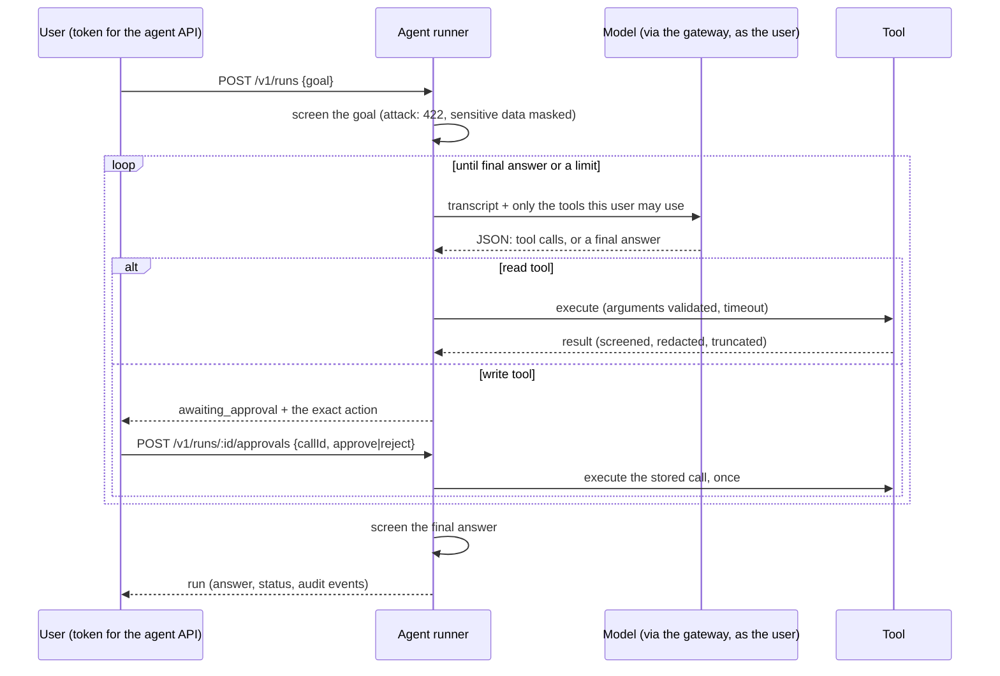

# agents

An agent that **uses tools to finish a goal**, as the calling user, with limits it cannot talk its way
past and a person's approval before it changes anything. Where the assistant can only give a wrong
answer, an agent can take a wrong action, so this service is about what is guaranteed when the model
misbehaves.

## How a run works



## What is enforced, and by whom

| Risk                             | Control (enforced in code, not by the model)                                       |
| -------------------------------- | ---------------------------------------------------------------------------------- |
| Runs forever                     | Step budget (default 6, hard ceiling 10), run deadline, per-call timeouts          |
| Repeats the same call            | Third identical call (argument order ignored) ends the run as `loop_detected`      |
| Asks for too much at once        | At most 3 calls per step; more is treated as a malformed reply                     |
| Sends garbage                    | Strict JSON protocol; one bad reply forgiven, two in a row end the run             |
| Calls a tool it should not       | Model sees only the tools the user's roles allow; others are refused like unknown  |
| Passes bad or smuggled arguments | Strict schemas: unknown fields (such as `approved: true`) are errors, nothing runs |
| Changes something unasked        | Every `write` tool pauses for the **run's owner**; approval names the stored call  |
| Approval runs twice              | Compare-and-swap on the run's revision: of two racing approvals, one wins (409)    |
| Approver deceived or mistaken    | Tools enforce their own rules (`send_email` checks the recipient domain)           |
| Hijack through a tool result     | Output screened like a source, redacted, delimited as data, truncated              |
| Leaks its instructions           | Per-call canary and instruction-leak check on the final answer                     |
| Nobody knows what happened       | Append-only audit events with who acted and argument digests, never raw content    |

The agent has **no access of its own**: it calls retrieval as the user (on-behalf-of), so tenant and
role trimming apply to everything it reads.

## Tools

| Tool               | Risk  | Roles needed              | Notes                                                |
| ------------------ | ----- | ------------------------- | ---------------------------------------------------- |
| `search_documents` | read  | any                       | Hybrid search as the user, access-trimmed            |
| `get_ticket`       | read  | `support`, `support-lead` | Tenant-scoped                                        |
| `create_ticket`    | write | `support`, `support-lead` | Idempotent on `runId:callId`                         |
| `send_email`       | write | `support-lead`            | Recipient domain allowlist (`EMAIL_ALLOWED_DOMAINS`) |

The ticket system and mailer are in-memory stand-ins behind interfaces; the point is the control
around them.

### Tools from the MCP gateway

With `MCP_GATEWAY_URL` set, the agent also gets the tools the [MCP gateway](../mcp-gateway/README.md)
allows **this user**, asked for on each request and named `<server>__<tool>`. The gateway has already
checked roles, approval and the tool's definition; the agent adds nothing to widen that. The gateway's
risk class carries over, so an MCP `write` tool pauses for the owner's approval exactly like a built-in
one, and the tool is looked up again at approval, so one that was withdrawn does not run. Descriptions
are screened again here, a built-in tool cannot be replaced by a name clash, and if the gateway is
down the agent keeps its built-in tools and the run continues.

## API

All routes need `Authorization: Bearer <JWT issued for the agent API>`.

| Route                         | Role                          | What it does                                                    |
| ----------------------------- | ----------------------------- | --------------------------------------------------------------- |
| `GET /v1/tools`               | `agent-user`                  | The tools this caller may use                                   |
| `POST /v1/runs`               | `agent-user`                  | Start a run `{goal, maxSteps?}`; returns when it ends or pauses |
| `GET /v1/runs/:id`            | `agent-user`, `agent-auditor` | The owner, or an auditor in the same tenant                     |
| `POST /v1/runs/:id/approvals` | `agent-user`                  | `{callId, decision: "approve" \| "reject"}`, owner only         |

A run is `running`, `awaiting_approval`, `completed` or `failed`. A failed run says why: `step_limit`,
`timeout`, `loop_detected`, `model_error`, `model_unavailable` or `answer_blocked`. The response never
includes the transcript (it holds tool output). The pending action's arguments go to the owner only.

| Status | `error.code`                                  | Meaning                                                   |
| ------ | --------------------------------------------- | --------------------------------------------------------- |
| 400    | `invalid_request`                             | Bad body (unknown fields are rejected)                    |
| 401    | `unauthorized`                                | No token, expired, or issued for another service          |
| 403    | `forbidden` / `not_run_owner`                 | Missing role, or not your run                             |
| 403    | `interaction_required`                        | The identity provider needs additional sign-in or consent |
| 404    | `run_not_found`                               | Unknown run, or another tenant's                          |
| 409    | `invalid_decision` / `conflict`               | Not waiting for that approval, or already decided         |
| 422    | `guardrail_blocked`                           | The goal looks like an attack on the agent                |
| 429    | `rate_limited` / `quota_exceeded`             | The user's limit, with `Retry-After`                      |
| 502    | `dependency_auth_failed` / `dependency_error` | Our own credentials or a service rejected us              |
| 503    | `agent_unavailable`                           | A dependency is down or slow; try again shortly           |

## See it work

```bash
npm install
npm run -s demo -w @genai/e2e
```

The last section of the demo runs the agent through the real platform: an access-trimmed search, an
email that waits for approval (and refuses a second approval and a colleague's), a model that never
stops, and one that obeys a poisoned document. Real output is in the
[root README](../../README.md#proof-tests-and-a-real-run).

## Configuration

The service **refuses to start** without `OBO_TOKEN_ENDPOINT` and `OBO_CLIENT_ID`, or without the auth
settings from [@genai/auth](../../packages/auth/README.md). See [`.env.example`](.env.example). The
client secret is read from the secret store by name, never from configuration. An unknown guardrail mode
or kind, or a default step budget above the hard ceiling, fails startup.

## Limits to know about

- A run executes **inside the request** (30 second default deadline); long agents need a queue and
  worker.
- Runs live in an **in-memory store**: lost on restart. Production target: Cosmos DB, partitioned by
  tenant.
- Only the **owner** can approve (continuing needs their token). Delegated approval and run
  cancellation are not built.
- The model protocol is JSON in plain chat, not native function calling. Everything was tested with
  scripted models, not a real one.

## Design

See [ADR 0011](../../docs/adr/0011-agent-orchestrator.md) and, for the screening it reuses,
[ADR 0010](../../docs/adr/0010-guardrails.md).

## Tests

```bash
npm test -w @genai/agents    # runner with misbehaving scripted models, tools (incl. MCP), protocol, HTTP API
npm test -w @genai/e2e       # the real services together, including the agent
```
