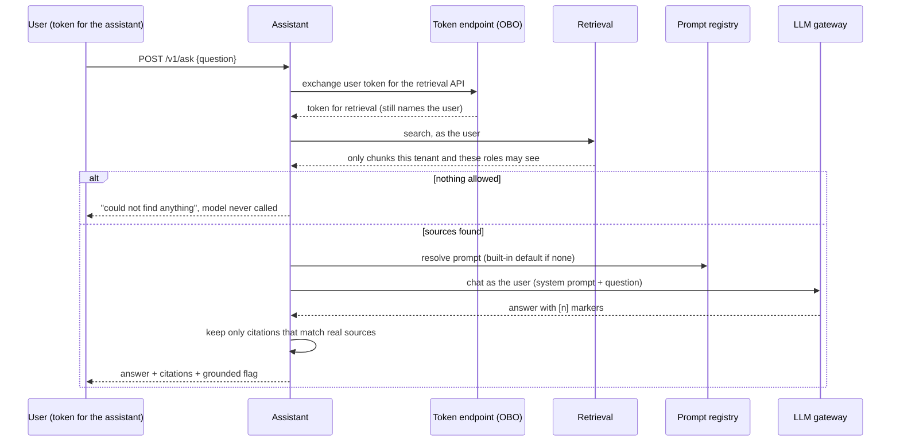

# assistant

Ask a question, get a **cited** answer, seeing only what you are allowed to see. This is the
service that ties the platform together: it calls retrieval, the prompt registry and the LLM
gateway **as the calling user**.

## How a question is answered



## See it work

```bash
npm install
npm run -s demo -w @genai/e2e
```

This starts the real services together and runs: the same question from an analyst and a manager
(different answers), another tenant, spoofed headers, and a token issued for the wrong service.
Real output is in the [root README](../../README.md#proof-tests-and-a-real-run).

## API

`POST /v1/ask` with `Authorization: Bearer <JWT issued for the assistant>`:

```json
{ "question": "How long do refunds take?", "topK": 4, "filter": { "tags": ["support"] } }
```

Only `question` is required (1 to 2000 characters). Who you are and what you may see come from the
token, never from the body or headers.

```json
{
  "requestId": "…",
  "answer": "Refunds take five working days to reach the original card. [1]",
  "grounded": true,
  "sourcesRetrieved": 1,
  "droppedCitations": [],
  "citations": [
    {
      "marker": 1,
      "documentId": "handbook",
      "chunkId": "handbook:0",
      "headingPath": ["Refunds"],
      "excerpt": "# Refunds Refunds take five working days …",
      "score": 1.4
    }
  ],
  "usage": { "promptTokens": 120, "completionTokens": 14, "totalTokens": 134 },
  "model": { "provider": "mock-grounded", "fallbackUsed": false },
  "prompt": { "name": "rag-answer", "version": 2, "source": "registry" }
}
```

- `grounded` is true only when the answer carries at least one citation that maps to a chunk that was
  actually retrieved for you. It does **not** verify that the chunk supports the claim.
- `droppedCitations` lists markers the model produced that matched no source; they are removed from
  the answer.
- When nothing you may see matches, `sourcesRetrieved` is 0, `usage`, `model` and `prompt` are absent,
  and the model was not called.

| Status | `error.code`                                  | Meaning                                                   |
| ------ | --------------------------------------------- | --------------------------------------------------------- |
| 400    | `invalid_request`                             | Bad question or parameters                                |
| 401    | `unauthorized`                                | No token, expired, or issued for another service          |
| 403    | `interaction_required`                        | The identity provider needs additional sign-in or consent |
| 429    | `rate_limited` / `quota_exceeded`             | Your tenant's limit; see `Retry-After`                    |
| 502    | `dependency_auth_failed` / `dependency_error` | Our own credentials or a service rejected us              |
| 503    | `assistant_unavailable`                       | A dependency is down or slow; try again shortly           |

## Configuration

The service **refuses to start** without `OBO_TOKEN_ENDPOINT` and `OBO_CLIENT_ID`, or without the
auth settings from [@genai/auth](../../packages/auth/README.md). See
[`.env.example`](.env.example). Its client secret is read from the secret store by name
(`OBO_CLIENT_SECRET_NAME`), never from configuration.

## Design

See [ADR 0008](../../docs/adr/0008-assistant-vertical-slice.md), including what this does **not**
prove (the model here is a deterministic test double). Documents reach search through the ingestion
service ([ADR 0009](../../docs/adr/0009-ingestion-to-search.md)).

## Tests

```bash
npm test -w @genai/assistant     # unit and HTTP tests with fake dependencies
npm test -w @genai/e2e           # the real services together, over HTTP
```
