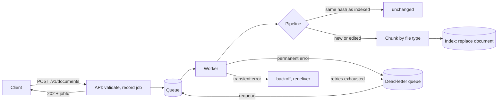

# ingestion

Turns documents into searchable chunks in the background. Uploads return immediately; a worker
chunks each document by file type, indexes it idempotently, retries transient failures, and parks
unprocessable documents in a dead-letter queue.

## How it works



## Chunking by file type

| Type     | Extensions        | Strategy                                                       |
| -------- | ----------------- | -------------------------------------------------------------- |
| Markdown | `.md` `.markdown` | Split at headings; heading path in metadata; code fences whole |
| Text     | `.txt` `.text`    | Paragraph and sentence packing with word-boundary overlap      |
| CSV      | `.csv`            | Whole rows grouped; header repeated in every chunk             |

Anything else (for example `.pdf`) is dead-lettered with `Unsupported file type`.

## Run it locally

```bash
npm install
npm run build
PORT=3002 node apps/ingestion/dist/main.js
```

```bash
# submit a document (returns 202 and a jobId)
curl -s -X POST localhost:3002/v1/documents \
  -H 'content-type: application/json' -H 'x-tenant-id: acme-bank' \
  -d '{"documentId":"faq","filename":"faq.md","content":"# Refunds\nRefunds take five days."}'

# check the job, then read the chunks
curl -s localhost:3002/v1/ingestions/<jobId> -H 'x-tenant-id: acme-bank'
curl -s localhost:3002/v1/documents/faq/chunks -H 'x-tenant-id: acme-bank'
```

## API

All routes need `x-tenant-id` (interim; replaced by token claims in Step 6).

| Method | Path                               | Purpose                                          |
| ------ | ---------------------------------- | ------------------------------------------------ |
| POST   | `/v1/documents`                    | Submit `{ documentId, filename, content }` (202) |
| GET    | `/v1/ingestions/:jobId`            | Job status and attempts                          |
| GET    | `/v1/documents/:documentId`        | Indexed document summary                         |
| GET    | `/v1/documents/:documentId/chunks` | The chunks, with metadata                        |
| GET    | `/v1/dead-letters`                 | This tenant's failed jobs and reasons            |
| POST   | `/v1/dead-letters/:jobId/requeue`  | Send a failed job back for another attempt       |

Job statuses: `queued`, `processing`, `succeeded`, `unchanged`, `failed` (dead-lettered).

| Status | `error.code`                                                   |
| ------ | -------------------------------------------------------------- |
| 400    | `invalid_tenant`, `invalid_request`                            |
| 404    | `job_not_found`, `document_not_found`, `dead_letter_not_found` |
| 413    | `document_too_large`                                           |

## Configuration

See `src/config/config.ts`: `POLL_INTERVAL_MS`, `MAX_DELIVERIES`, `VISIBILITY_TIMEOUT_MS`,
`RETRY_BASE_DELAY_MS`, `RETRY_MAX_DELAY_MS`, `CHUNK_MAX_CHARS`, `CHUNK_OVERLAP_CHARS`,
`MAX_DOCUMENT_BYTES`.

## Design

See [ADR 0005](../../docs/adr/0005-queue-driven-ingestion.md).

## Tests

```bash
npm test -w @genai/ingestion
```
