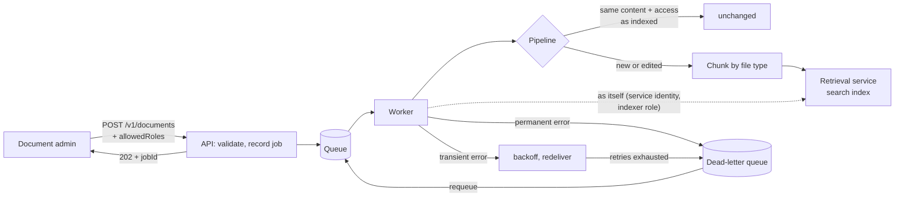

# ingestion

Turns uploaded documents into **searchable, access-controlled** chunks in the background. Uploads
return immediately; a worker chunks each document by file type, writes it to the search index with
its access list, retries transient failures, and parks unprocessable documents in a dead-letter
queue.

## How it works



The worker has no user, so it writes to search with its **own** service identity and names the tenant
the upload belongs to. That tenant was fixed from the uploader's verified token when the document was
submitted. See [ADR 0009](../../docs/adr/0009-ingestion-to-search.md).

## Chunking by file type

| Type     | Extensions        | Strategy                                                       |
| -------- | ----------------- | -------------------------------------------------------------- |
| Markdown | `.md` `.markdown` | Split at headings; heading path in metadata; code fences whole |
| Text     | `.txt` `.text`    | Paragraph and sentence packing with word-boundary overlap      |
| CSV      | `.csv`            | Whole rows grouped; header repeated in every chunk             |

Anything else (for example `.pdf`) is dead-lettered with `Unsupported file type`.

## Upload, then ask

The quickest way to see the whole path (upload, ingest, index, then an answer with a citation, and
access being tightened) is the demo, which runs all the real services together:

```bash
npm install
npm run -s demo -w @genai/e2e
```

To run this service on its own with the in-memory sink (documents are processed but **not**
searchable):

```bash
npm run build
eval "$(npm run -s dev-token -w @genai/auth -- env)"   # trust locally minted dev tokens
PORT=3002 node apps/ingestion/dist/main.js
```

```bash
ADMIN=$(npm run -s dev-token -w @genai/auth -- mint --tenant acme-bank --roles document-admin)

# upload a document only managers may read (returns 202 and a jobId)
curl -s -X POST localhost:3002/v1/documents \
  -H 'content-type: application/json' -H "authorization: Bearer $ADMIN" \
  -d '{"documentId":"salary","filename":"salary.md","content":"# Salary bands\nBands start at M1.","allowedRoles":["manager"]}'

# check the job
curl -s localhost:3002/v1/ingestions/<jobId> -H "authorization: Bearer $ADMIN"
```

## API

All routes need `Authorization: Bearer <JWT>`; the tenant comes from the verified token (see
[ADR 0007](../../docs/adr/0007-authentication-and-authorization.md)).

| Method | Path                              | Role              | Purpose                                                                |
| ------ | --------------------------------- | ----------------- | ---------------------------------------------------------------------- |
| POST   | `/v1/documents`                   | `document-admin`  | Submit `{ documentId, filename, content, allowedRoles?, tags? }` (202) |
| GET    | `/v1/ingestions/:jobId`           | `document-admin`  | Job status and attempts                                                |
| GET    | `/v1/documents/:documentId`       | `document-admin`  | Whether indexed: hash and chunk count, never text                      |
| GET    | `/v1/dead-letters`                | `ingestion-admin` | This tenant's failed jobs and reasons                                  |
| POST   | `/v1/dead-letters/:jobId/requeue` | `ingestion-admin` | Send a failed job back for another attempt                             |

- **Who can read an upload** is set by `allowedRoles` (empty or omitted means the whole tenant) and
  enforced by the retrieval service when someone asks a question.
- There is **no endpoint that returns document content.** Only retrieval serves content, after
  trimming by the caller's tenant and roles.
- Re-uploading identical text is skipped as `unchanged`, but changing only `allowedRoles` is applied,
  never skipped: the unchanged check covers the access list as well as the text.

Job statuses: `queued`, `processing`, `succeeded`, `unchanged`, `failed` (dead-lettered).

| Status | `error.code`                                                   |
| ------ | -------------------------------------------------------------- |
| 400    | `invalid_request`                                              |
| 401    | `unauthorized` (missing, expired or invalid token)             |
| 403    | `forbidden` (needs `document-admin` or `ingestion-admin`)      |
| 404    | `job_not_found`, `document_not_found`, `dead_letter_not_found` |
| 413    | `document_too_large`                                           |

## Configuration

See [`.env.example`](.env.example) and `src/config/config.ts`. The service **refuses to start**
without the auth settings from [@genai/auth](../../packages/auth/README.md).

- **`INDEX_SINK`**: `retrieval` writes to the search index; `memory` (default) keeps chunks in this
  process, so uploads are **not** searchable and the service logs a warning saying so. Choosing
  `retrieval` also requires `RETRIEVAL_URL`, `TOKEN_ENDPOINT` and `CLIENT_ID`; the client secret is
  read from the secret store by name (`CLIENT_SECRET_NAME`), never from configuration.
- Queue and retry: `POLL_INTERVAL_MS`, `MAX_DELIVERIES`, `VISIBILITY_TIMEOUT_MS`,
  `RETRY_BASE_DELAY_MS`, `RETRY_MAX_DELAY_MS`.
- Chunking and limits: `CHUNK_MAX_CHARS`, `CHUNK_OVERLAP_CHARS`, `MAX_DOCUMENT_BYTES` (200 KB; queue
  messages are size-limited).

## Design

[ADR 0005](../../docs/adr/0005-queue-driven-ingestion.md) (queue, idempotency, dead letters) and
[ADR 0009](../../docs/adr/0009-ingestion-to-search.md) (connecting to search, service identity,
access lists). Known gaps: no delete, no PDF/Office, no malware scanning, and a document admin is
trusted to choose an access list.

## Tests

```bash
npm test -w @genai/ingestion     # unit and HTTP tests, plus the retrieval index adapter
npm test -w @genai/e2e           # the real services together, including upload then ask
```
