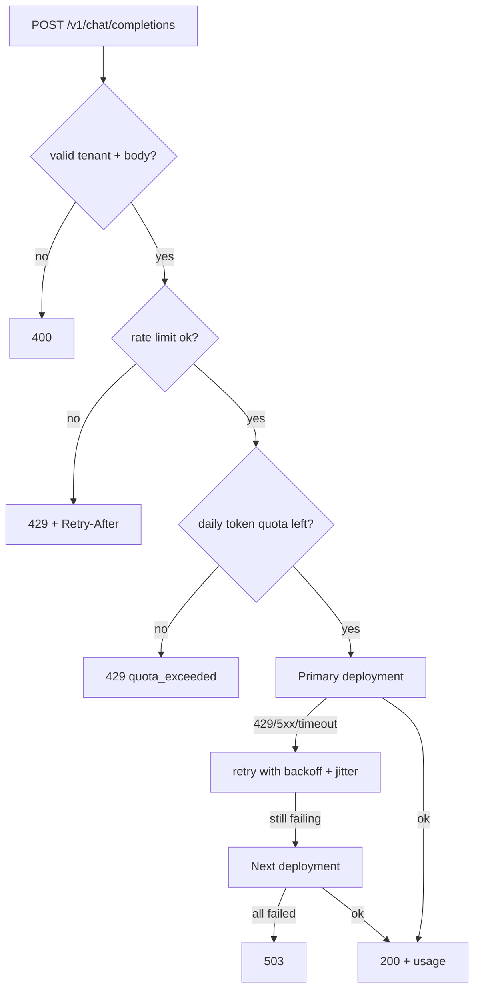

# llm-gateway

One internal API in front of Azure OpenAI deployments. Services call the gateway, never the model
vendor directly, so limits, retries, fallback and (later) auth, caching and tracing live in one place.

## Request flow



## Run it locally (no cloud account needed)

```bash
npm install
npm run build
PORT=3000 node apps/llm-gateway/dist/main.js
```

```bash
curl -s -X POST localhost:3000/v1/chat/completions \
  -H 'content-type: application/json' -H 'x-tenant-id: acme-bank' \
  -d '{"messages":[{"role":"user","content":"What is RAG?"}]}'
```

The default `LLM_PROVIDER=mock` echoes your message. To use Azure OpenAI set `LLM_PROVIDER=azure`
and `AZURE_OPENAI_DEPLOYMENTS` (see [`.env.example`](.env.example)). Order matters: first entry is
the primary, the rest are fallbacks.

## API

`POST /v1/chat/completions` with header `x-tenant-id` (interim; replaced by JWT in Step 6).

| Status | `error.code`                | Meaning                                      |
| ------ | --------------------------- | -------------------------------------------- |
| 200    |                             | Completion returned                          |
| 400    | `invalid_tenant`            | Header missing or not a valid tenant slug    |
| 400    | `invalid_request`           | Body failed validation (`issues` lists them) |
| 400    | `upstream_rejected_request` | Model rejected the request itself            |
| 429    | `rate_limited`              | Too many requests; see `Retry-After`         |
| 429    | `quota_exceeded`            | Tenant's daily token budget is spent         |
| 503    | `upstream_unavailable`      | Every configured deployment failed           |

## Design

See [ADR 0003](../../docs/adr/0003-gateway-resilience-and-limits.md).

## Tests

```bash
npm test -w @genai/llm-gateway
```
