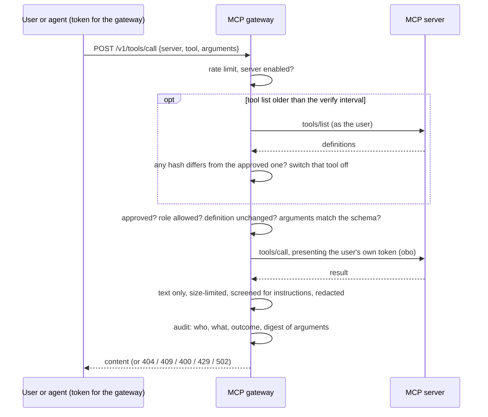

# mcp-gateway

The one place where **MCP tool servers** are approved, permissioned and watched. An agent (or any
client) never talks to a tool server directly: it asks the gateway, which decides whether the tool may
be called, by this user, right now, and writes down that it did.

MCP is the common way to plug other systems into an AI: a server publishes tools (a name, a description
the model reads, an input schema) and answers `tools/call`. That is useful and risky: a tool definition
is text someone else wrote that the model will obey, a server can change it after it was vetted, its
address is supplied by an admin, and its results are more untrusted text.

## How a call is checked



## What is enforced, and by whom

| Risk                                            | Control                                                                                                |
| ----------------------------------------------- | ------------------------------------------------------------------------------------------------------ |
| A new tool nobody reviewed gets used            | Default deny: `pending` until an admin approves a specific definition for named roles                  |
| Approving something other than what was read    | Approval must quote the reviewed hash; if the definition changed since, it is refused (409)            |
| Server changes a tool after approval (rug pull) | Hash pinned at approval; list re-read past `VERIFY_TTL_MS`; a changed tool is off until re-reviewed    |
| Cannot re-check a tool                          | The call fails closed                                                                                  |
| Instructions hidden in a tool definition        | Description and every schema string screened; hostile ones **quarantined** and not approvable          |
| Text too long to review                         | Quarantined (`description_too_long`), never truncated and approved                                     |
| Server URL aims the gateway at internal systems | Host policy: public https only; every resolved address checked at connect time; no redirects           |
| Huge or endless responses                       | Size cap and deadline on every upstream request                                                        |
| Wrong arguments reach a server                  | Validated against the published schema before forwarding; messages never echo the values               |
| Result hijacks the model                        | Text only, size-limited, screened (withheld if it instructs), redacted; the server's error text unused |
| Server learns nothing about who is asking       | `obo` presents the user's own token for the server's audience                                          |
| Probing for tools one may not use               | Unknown, unapproved, disabled and forbidden all give the same 404                                      |
| One caller hammers a server                     | Per-user rate limit (429 with Retry-After); a kill switch per server                                   |
| Nobody knows who did what                       | Append-only audit log (digests, never arguments or results), readable only by `mcp-auditor`            |

## Roles

| Role          | May                                                                       |
| ------------- | ------------------------------------------------------------------------- |
| `mcp-admin`   | Register, refresh, approve, disable and remove servers. Cannot call tools |
| `mcp-user`    | List and call the tools their own roles allow                             |
| `mcp-auditor` | Read the audit log of their tenant. Nothing else                          |

Everything is tenant-scoped: another tenant's server is simply not found.

## API

All routes need `Authorization: Bearer <JWT issued for the gateway>`.

| Route                                    | Role          | What it does                                                           |
| ---------------------------------------- | ------------- | ---------------------------------------------------------------------- |
| `POST /v1/servers`                       | `mcp-admin`   | Register `{id, name, url, auth}`; tools are discovered as `pending`    |
| `GET /v1/servers`, `GET /v1/servers/:id` | `mcp-admin`   | Servers with each tool's status, full definition and hash              |
| `POST /v1/servers/:id/refresh`           | `mcp-admin`   | Re-read the tools; changed ones switch off. Returns what changed       |
| `PUT /v1/servers/:id/tools/:tool/policy` | `mcp-admin`   | `{reviewedHash, enabled, allowedRoles, risk}`                          |
| `PUT /v1/servers/:id/state`              | `mcp-admin`   | `{enabled}`: the kill switch                                           |
| `DELETE /v1/servers/:id`                 | `mcp-admin`   | Remove a server                                                        |
| `GET /v1/tools`                          | `mcp-user`    | Only the tools this caller could actually call, with the risk class    |
| `POST /v1/tools/call`                    | `mcp-user`    | `{server, tool, arguments}` returns text content and flags             |
| `GET /v1/audit`                          | `mcp-auditor` | Newest first; filters `server`, `userId`, `action`, `outcome`, `limit` |

`auth` is `{"kind":"none"}`, `{"kind":"obo","scope":"api://crm/.default"}` (the server sees the calling
user) or `{"kind":"secret","secretName":"crm-key"}` (one shared credential: every caller has the same
access upstream).

A tool is `pending`, `approved`, `changed` (switched off until reviewed), `quarantined` (hostile or
malformed, cannot be approved) or `removed`.

| Status  | `error.code`                                    | Meaning                                                             |
| ------- | ----------------------------------------------- | ------------------------------------------------------------------- |
| 400     | `invalid_request` / `invalid_arguments`         | Bad body, or arguments that do not match the tool's schema          |
| 400     | `server_url_not_allowed`                        | The address is one the gateway must not connect to                  |
| 401/403 | `unauthorized` / `forbidden`                    | No token, wrong audience, or missing role                           |
| 403     | `interaction_required`                          | The identity provider needs additional sign-in or consent           |
| 404     | `tool_not_available` / `server_not_found`       | Unknown, unapproved, disabled or not permitted: indistinguishable   |
| 409     | `tool_changed`                                  | The tool changed and awaits review (only told to permitted callers) |
| 409     | `definition_changed` / `tool_quarantined`       | Approval of a stale or hostile definition                           |
| 409     | `server_exists` / `limit_exceeded` / `conflict` | Duplicate id, too many servers or tools, concurrent edit            |
| 429     | `rate_limited`                                  | Your limit, with `Retry-After`                                      |
| 502/504 | `upstream_error` / `upstream_timeout`           | The tool server failed; its own message is never relayed            |

## See it work

```bash
npm install
npm run -s demo -w @genai/e2e
```

The MCP section of the demo registers a real CRM server, shows nothing callable until approved, the
server seeing the calling user, a definition changing after approval, SSRF addresses refused, the agent
writing only after approval, and the audit counts. Output is in the
[root README](../../README.md#proof-tests-and-a-real-run).

## Configuration

The service **refuses to start** without `OBO_TOKEN_ENDPOINT` and `OBO_CLIENT_ID`, or without the auth
settings from [@genai/auth](../../packages/auth/README.md). See [`.env.example`](.env.example). It is
locked down by default: `ALLOWED_HOSTS` is empty (public https only), guardrails enforce, and an unknown
mode or kind fails startup. Keep `ALLOWED_HOSTS` empty in production.

## Limits to know about

- The registry **and the audit log are in memory**: lost on restart. Production needs Cosmos DB with
  immutable storage for the log.
- Streamable HTTP and tools only (no stdio, resources, prompts or sampling). Each operation opens its
  own short session.
- The rate limit is per process. A tool whose _behaviour_ changes while its definition does not cannot
  be detected. Within `VERIFY_TTL_MS` a changed definition goes unnoticed.

## Design

See [ADR 0012](../../docs/adr/0012-mcp-gateway.md). The agent that consumes these tools is described in
[apps/agents](../agents/README.md).

## Tests

```bash
npm test -w @genai/mcp-gateway    # against a real MCP server over HTTP, plus the HTTP API
npm test -w @genai/e2e            # the gateway, a real CRM and the agent together
```
