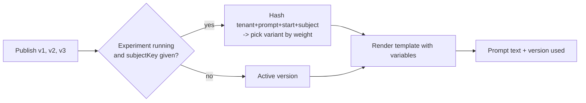

# prompt-registry

Versioned prompt storage with instant rollback and sticky A/B experiments. Services ask the registry
for a prompt by name instead of hard-coding prompt text, so prompts can change without a deploy.

## Concepts

- **Version:** an immutable snapshot of a prompt template. Editing creates the next version.
- **Active version:** the one served by default. The first version is activated automatically; later
  ones stay inactive until you activate them.
- **Rollback:** activate an older version. Nothing is deleted; the history records who did it.
- **Experiment:** split traffic across two or more versions by weight. Each user (`subjectKey`)
  always sees the same variant.



## Run it locally

```bash
npm install
npm run build
PORT=3001 node apps/prompt-registry/dist/main.js
```

```bash
# publish a version (the first one becomes active)
curl -s -X POST localhost:3001/v1/prompts/support-reply/versions \
  -H 'content-type: application/json' -H 'x-tenant-id: acme-bank' \
  -d '{"template":"Answer politely: {{question}}"}'

# resolve it
curl -s -X POST localhost:3001/v1/prompts/support-reply/resolve \
  -H 'content-type: application/json' -H 'x-tenant-id: acme-bank' \
  -d '{"variables":{"question":"Where is my card?"}}'
```

## API

All routes need `x-tenant-id` (interim; replaced by token claims in Step 6). `x-user-id` is recorded
as the actor in the history.

| Method | Path                            | Purpose                                       |
| ------ | ------------------------------- | --------------------------------------------- |
| GET    | `/v1/prompts`                   | List prompt summaries for the tenant          |
| GET    | `/v1/prompts/:name`             | Versions, active version, history, A/B        |
| POST   | `/v1/prompts/:name/versions`    | Publish a new version `{ template, note }`    |
| GET    | `/v1/prompts/:name/versions/:n` | Read one version                              |
| PUT    | `/v1/prompts/:name/active`      | Activate or roll back `{ version }`           |
| PUT    | `/v1/prompts/:name/experiment`  | Start A/B `{ variants: [{version, weight}] }` |
| DELETE | `/v1/prompts/:name/experiment`  | Stop the experiment                           |
| POST   | `/v1/prompts/:name/resolve`     | Render `{ variables, subjectKey? }`           |

| Status | `error.code`                                                                                     |
| ------ | ------------------------------------------------------------------------------------------------ |
| 400    | `invalid_tenant`, `invalid_request`, `invalid_prompt`, `invalid_experiment`, `missing_variables` |
| 404    | `prompt_not_found`, `version_not_found`                                                          |
| 409    | `conflict` (concurrent edit; reload and retry)                                                   |

## Design

See [ADR 0004](../../docs/adr/0004-prompt-registry-design.md).

## Tests

```bash
npm test -w @genai/prompt-registry
```
