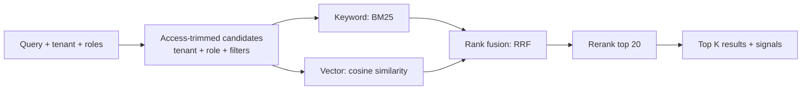

# retrieval

Finds the chunks that answer a question, using keyword and vector search together, and only ever
returns what the caller is allowed to see.

## How a search works



1. **Trim first.** Only chunks of the caller's tenant that their roles may read are candidates.
   Nothing later can see, score or leak anything else.
2. **Two retrievers.** BM25 is strong on exact terms and codes; vector similarity tolerates other
   wording and word forms.
3. **Fuse by rank** (Reciprocal Rank Fusion), so no score tuning is needed.
4. **Rerank** the best few by how fully they answer the query.

## Run it locally

```bash
npm install
npm run build
eval "$(npm run -s dev-token -w @genai/auth -- env)"   # trust locally minted dev tokens
PORT=3003 node apps/retrieval/dist/main.js
```

```bash
mint() { npm run -s dev-token -w @genai/auth -- mint --tenant acme-bank --roles "$1"; }

# index a document (needs the `indexer` role), restricted to managers
curl -s -X PUT localhost:3003/v1/index/documents/salary \
  -H 'content-type: application/json' -H "authorization: Bearer $(mint indexer)" \
  -d '{"chunks":[{"index":0,"text":"Confidential salary bands for managers"}],"allowedRoles":["manager"]}'

# search as an analyst (sees nothing) and as a manager (sees it)
curl -s -X POST localhost:3003/v1/search \
  -H 'content-type: application/json' -H "authorization: Bearer $(mint analyst)" \
  -d '{"query":"salary bands"}'
curl -s -X POST localhost:3003/v1/search \
  -H 'content-type: application/json' -H "authorization: Bearer $(mint manager)" \
  -d '{"query":"salary bands"}'
```

## API

Every route needs `Authorization: Bearer <JWT>`. Tenant **and roles** come from the verified token
(see [ADR 0007](../../docs/adr/0007-authentication-and-authorization.md)), so a client cannot widen
what it sees by sending a header: that is what makes the access trimming trustworthy. Search is open
to any authenticated user (and trimmed to their tenant and roles). Changing the index needs the
`indexer` role, which belongs to the ingestion pipeline's service identity, not to end users.

| Method | Path                      | Purpose                                          |
| ------ | ------------------------- | ------------------------------------------------ |
| PUT    | `/v1/index/documents/:id` | Replace a document's chunks (idempotent)         |
| DELETE | `/v1/index/documents/:id` | Remove a document                                |
| POST   | `/v1/search`              | Search; returns ranked chunks with their signals |

`PUT` body: `{ chunks: [{ index, text, metadata? }], allowedRoles?, tags? }`. Empty `allowedRoles`
means anyone in the tenant.

`POST /v1/search` body: `{ query, topK (1-20, default 5), mode: "hybrid" | "keyword" | "vector",
rerank (default true), filter?: { documentIds?, tags? } }`.

Each result carries `signals` (`keywordRank`, `keywordScore`, `vectorRank`, `vectorScore`,
`fusedScore`, `rerankScore`) showing exactly why it ranked where it did.

| Status | `error.code`                                       |
| ------ | -------------------------------------------------- |
| 400    | `invalid_request`                                  |
| 401    | `unauthorized` (missing, expired or invalid token) |
| 403    | `forbidden` (index changes need `indexer`)         |
| 404    | `document_not_found` (delete)                      |

## Local stand-ins

| Part     | Locally                                 | Production                                  |
| -------- | --------------------------------------- | ------------------------------------------- |
| Index    | In-memory                               | Azure AI Search (pre-filter on tenant/role) |
| Embedder | Feature hashing (spelling overlap only) | Azure OpenAI embeddings via the gateway     |
| Reranker | Query-coverage heuristic                | Cross-encoder or semantic ranker            |

The hashing embedder does **not** understand meaning ("reimbursement" does not match "refund").
It exists so the full pipeline, fusion and access control run and test on a laptop.

## Design

See [ADR 0006](../../docs/adr/0006-hybrid-retrieval-and-access-trimming.md).

## Tests

```bash
npm test -w @genai/retrieval
```
